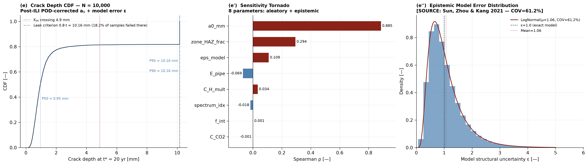
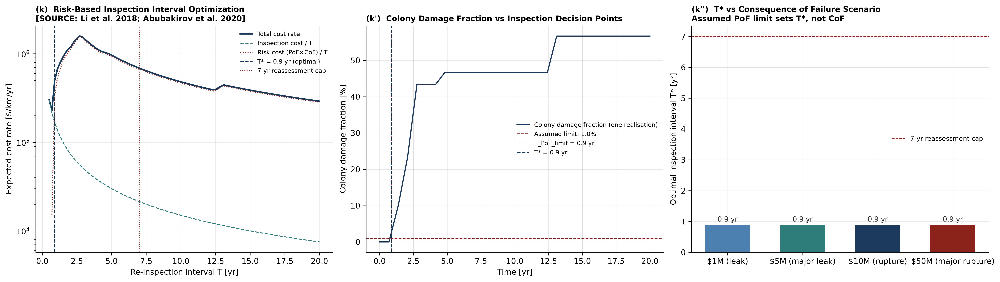

# Integrity Code Series — Week 10 — NNpHSCC Full-Physics Simulation

[](https://github.com/felipearocha/integrity-code-series-week10-nnph-scc/actions/workflows/ci.yml)
[](LICENSE)
[](https://www.python.org/downloads/)
[](tests)
[](https://doi.org/10.5281/zenodo.20172241)

**Author:** Felipe Rocha — Independent Researcher

Physics-first simulator for Near-Neutral pH Stress Corrosion Cracking (NNpHSCC) on gas
transmission pipelines: crack growth with the Chen-Sutherby-Xing combined parameter, Newman-Raju
geometry, dormancy, coalescence, a post-ILI Monte Carlo that samples model error explicitly, and
a Bayesian update from re-inspection.

## Problem Statement

Near-Neutral pH Stress Corrosion Cracking (NNpHSCC) accounts for a major fraction of
reportable incidents on gas transmission pipelines in North America. Two specific incidents
motivate this package:

- **2018 Prince George, BC rupture** — 914mm gas pipeline; NNpHSCC; downstream of a compressor station (Transportation Safety Board of Canada investigation)
- **2015 Unityville, PA rupture** — 609mm gas pipeline; NNpHSCC (US DOT/PHMSA failure investigation)

PHMSA §192.611(a)(4) (effective March 16, 2026) adds an integrity-management alternative for
confirming or restoring MAOP on eligible Class 3 segments after a class location change. Segments
with an in-service leak or rupture due to cracking on the segment, or on similar pipe within
5 miles, are excluded, so crack threats bear directly on its use. This package provides physics
background for evaluating that threat; it is not a compliance determination.

**Key finding from v2:** the HEDE component of Xing's model, the most accurate of the models
reviewed by Sun, Zhou & Kang (2021), still has COV = 61.2% against 39 crack growth rates from
full-scale tests. This package incorporates that model structural uncertainty as a sampled
variable — not a footnote.

## Results

From `python run_all.py` (seed 42). The inputs are the nominal and `[ASSUMED]` values in
`src/constants.py`, so these numbers illustrate the model and do not describe a real pipeline.

| Output | Value |
|---|---|
| Base metal, $a_0$ = 0.5 mm | 0.510 mm after 20 yr, dormant |
| HAZ, $a_0$ = 1.5 mm, model error 1.3 | leak (80% of wall, 10.16 mm) at 0.72 yr, before collapse or $K_{IC}$ |
| Depth where $K_I$ reaches $K_{IH}$ (base metal, c/a = 4) | 4.88 mm |
| Monte Carlo, N = 10,000, post-ILI | PoF = 0.1821 at 20 yr; every failure is a leak (80% of wall) |
| Monte Carlo crack depth at 20 yr | P50 = 0.953 mm; P90 = P95 = 10.160 mm, the leak depth at which failed samples stop |
| GBR surrogate | $R^2$ = 0.9149, MAE = 0.292 mm |
| Colony, 25 cracks, one realisation | 25/25 dormant at start, 19 merges, damage fraction 0.880 at 20 yr |
| Bayesian update, two detections | $a_0$ P50 0.826 mm to 1.282 mm, ESS 1000, 723, 400 |
| Crack growth rate vs potential | 1.0x at -750 mV, 2.0x at -850 mV, 5.0x at free corrosion |
| $K_{IH}$ at 10% / 30% / 100% H₂ | 14.2 / 10.0 / 5.5 MPa√m |
| Re-inspection interval $T^{*}$ | 0.9 yr, set by the assumed 1% limit and not by CoF |

Monte Carlo sensitivity and crack depth distribution:



Inspection interval analysis:



All nine panels are in [`assets/figures/`](assets/figures), with the colony animation in
[`assets/animations/`](assets/animations).

## Governing Equations

[**view the full rendered reference**](https://htmlpreview.github.io/?https://github.com/felipearocha/integrity-code-series-week10-nnph-scc/blob/main/docs/equations.html)

Every constant is tagged to its source or to `[ASSUMED]`. The equations below are the ones the
code solves; the complete set is in **[docs/equations.html](docs/equations.html)**.

### Chen-Sutherby-Xing crack growth
**[SOURCE: Chen & Sutherby 2007; Xing et al. via Sun et al. 2021]**

```math
\frac{da}{dN} = A_{\mathrm{CF}}\,\bigl(K_{\max}\,\Delta K^{2}\,f_{\mathrm{eff}}^{-0.1}\bigr)^{n}\;\Phi_{\mathrm{HE}}\;f_{\mathrm{micro}}\;\varepsilon_{\mathrm{model}}
```

```math
f_{\mathrm{eff}} = \max(f,\,f_{\mathrm{crit}}), \qquad \Phi_{\mathrm{HE}} = \max\!\left[\left(\frac{C_H}{C_{H,\mathrm{ref}}}\right)^{n_{\mathrm{HE}}},\;0.1\right]
```

$a$ is crack depth [m], $N$ cycles, $K_{\max}$ and $\Delta K$ the peak and range of stress
intensity [MPa√m], $f$ the loading frequency [Hz] with $f_{\mathrm{crit}}$ = 10⁻³ Hz, $n$ = 2,
$A_{\mathrm{CF}}$ = 4.0×10⁻¹⁴ `[ASSUMED]`, $C_H$ the hydrogen concentration [mol/m³] with
$C_{H,\mathrm{ref}}$ = 0.001 mol/m³ `[ASSUMED]`, $n_{\mathrm{HE}}$ = 0.88, $f_{\mathrm{micro}}$
the microstructure factor and $\varepsilon_{\mathrm{model}}$ the model error.

### Hydrogen entry at the pipe surface
**[ASSUMED, calibrated to H-permeation trends]**

```math
C_H = C_{H,\mathrm{bulk}}\;e^{\,k_H\,(E_{\mathrm{CP}} - E_{\mathrm{pipe}})}\;10^{-0.3\,(\mathrm{pH}-7)}, \qquad C_H \le 0.15\ \mathrm{mol/m^3}
```

$E_{\mathrm{pipe}}$ is the pipe-to-soil potential [V CSE], an input to the model,
$E_{\mathrm{CP}}$ = -0.85 V, $k_H$ = 5.5 V⁻¹ and $C_{H,\mathrm{bulk}}$ = 0.02 mol/m³.

### Oriani-Fick hydrogen diffusion in the steel wall
**[SOURCE: Kiuchi & McLellan 1983; Turnbull 1996; San Marchi 2012]**

```math
\frac{\partial C_L}{\partial t} = D_{\mathrm{eff}}(T,\sigma_h)\,\frac{\partial^{2} C_L}{\partial r^{2}} + \frac{D_{\mathrm{eff}}\,V_H}{R\,T}\,\frac{\partial}{\partial r}\!\left(C_L\,\frac{\partial \sigma_h}{\partial r}\right)
```

$C_L$ is lattice hydrogen [mol/m³], $D_{\mathrm{eff}}$ the trap-corrected diffusivity [m²/s],
$\sigma_h$ the hydrostatic stress [Pa], $V_H$ the partial molar volume of hydrogen [m³/mol], $R$
the gas constant, $T$ temperature [K] and $r$ the through-wall coordinate [m]. Implemented in
`src/hydrogen_diffusion.py` (`run_H_diffusion`) as a standalone module: the crack-growth pipeline
uses the surface value above and does not call this solver.

### Stress intensity factor — Newman-Raju surface crack
**[SOURCE: Newman & Raju 1981]**

```math
K_I = \sigma_h\,\sqrt{\frac{\pi\,a}{Q}}\;F, \qquad Q = 1 + 1.464\left(\frac{a}{c}\right)^{1.65}, \qquad F = M_1 + M_2\left(\frac{a}{t}\right)^{2} + M_3\left(\frac{a}{t}\right)^{4}
```

Here $\sigma_h$ is the hoop stress [MPa], $c$ the half-length, $t$ the wall thickness, and
$M_1$, $M_2$, $M_3$ the Newman-Raju functions of $a/c$ at the deepest point.

### Crack-tip acidification
**[SOURCE: Turnbull 1993, simplified; coefficients ASSUMED]**

```math
\mathrm{pH}_{\mathrm{tip}} = \mathrm{pH}_{\mathrm{bulk}} - 0.6\,\log_{10}\!\left(\frac{c}{a}\right) - 0.3\,v_{\mathrm{diss}} + 0.3\,\log_{10}(b + 1)
```

$v_{\mathrm{diss}}$ is the dissolution rate [mm/yr] and $b$ the HCO₃⁻/CO₂ concentration ratio,
limited to 2. The result is limited to the range from 4.5 to $\mathrm{pH}_{\mathrm{bulk}}$.

### Model structural uncertainty
**[SOURCE: Sun, Zhou & Kang 2021 — 39 crack growth rates from CanmetMATERIALS full-scale tests]**

```math
\left(\frac{da}{dt}\right)_{\mathrm{real}} = \left(\frac{da}{dt}\right)_{\mathrm{model}}\varepsilon_{\mathrm{model}}, \qquad \varepsilon_{\mathrm{model}} \sim \mathrm{LogNormal}(\mathrm{mean}=1.06,\ \mathrm{COV}=61.2\%)
```

### ILI probability of detection
**[ASSUMED: Weibull form]**

```math
\mathrm{POD}(a) = 1 - \exp\!\left[-\ln(10)\left(\frac{a}{a_{90}}\right)^{k}\right]
```

$a_{90}$ = 4 mm is the depth with POD = 90%, and $k$ = 2.

### API 579-1 Level 2 FAD curve
**[SOURCE: API 579-1/ASME FFS-1 Level 2, as quoted in Bourga et al. 2016]**

```math
K_r = \bigl(1 - 0.14\,L_r^{2}\bigr)\bigl(0.3 + 0.7\,e^{-0.65\,L_r^{6}}\bigr), \qquad L_r \le L_{r,\max} = \frac{1}{2}\left(1 + \frac{\sigma_{\mathrm{UTS}}}{\sigma_{\mathrm{SMYS}}}\right)
```

$K_r = K_I/K_{\mathrm{mat}}$ with $K_{\mathrm{mat}}$ = 70 MPa√m `[ASSUMED]`, and $L_r$ is the hoop
stress on the remaining wall divided by SMYS.

### H₂ blending — $K_{IH}$ degradation
**[SOURCE: Cui et al. 2024 at 3% and 10% H₂ and 40% CO₂; other table points ASSUMED]**

```math
K_{IH}(x_{\mathrm{H_2}}, x_{\mathrm{CO_2}}) = \frac{K_{IH,0}\;\mathrm{HDF}(x_{\mathrm{H_2}})}{\sqrt{c(x_{\mathrm{CO_2}})}}
```

$x$ is the mole fraction. HDF and $c$ are interpolated from `H2_BLEND_TABLE` and
`CO2_SYNERGY_TABLE` in `src/h2_blending.py`; the square root is `[ASSUMED]`, and the result is
limited to the range from 5 MPa√m to $K_{IH,0}$ = 25 MPa√m.

### Re-inspection interval
**[ASSUMED cost parameters and PoF limit]**

```math
\mathcal{C}(T) = \frac{C_{\mathrm{insp}} + \mathrm{PoF}(T)\,\mathrm{CoF}}{T}, \qquad T^{*} = \min\!\left(\arg\min_{T}\,\mathcal{C}(T),\;T_{\mathrm{PoF\,lim}}\right)
```

$T$ is the interval [yr], $C_{\mathrm{insp}}$ and CoF are costs [USD/km], and
$T_{\mathrm{PoF\,lim}}$ is the time when PoF reaches the assumed 1% limit. The result is also
checked against the seven-year reassessment cap in 49 CFR 192 subpart O.

## Quick Start

```bash
# Clone and install
git clone https://github.com/felipearocha/integrity-code-series-week10-nnph-scc.git
cd integrity-code-series-week10-nnph-scc
pip install -e .[dev]

# Validate
pytest tests/ -q                          # 221 tests
python -m validation.benchmarks           # textbook constants

# Reproduce all panels + audit-chained outputs
python run_all.py
```

`run_all.py` takes about 2-3 minutes and overwrites the panels in `assets/`. Pixel differences
are expected across matplotlib versions and fonts.

## Limitations

- **No soil potential solve.** `E_pipe` is an input. The Laplace equation in `docs/equations.html`
  is background and is not solved here.
- **Hydrogen diffusion is not coupled.** The Oriani-Fick solver is standalone; crack growth uses
  the surface concentration.
- **Xing term is simplified.** In Sun et al. (2021), $n$ is a fitted exponent of the HEDE growth
  rate, 0.92 for X65 and 0.88 for X52. Here it is applied to a concentration ratio, with the X52
  value on X65 pipe.
- **The inspection interval uses a colony damage fraction** from one realisation as PoF. The 1%
  limit and the cost figures are assumptions, not regulation.
- **FAD inputs are simplified.** $K_{\mathrm{mat}}$ is assumed, and the HAZ curve in panel (h')
  uses $K_{IH}$ as a screening toughness.
- **Standards.** API 579-1 and BS 7910 were not checked against the standards themselves. The FAD
  curve comes from a published paper that quotes API 579-1. The B31.12 factor `HDF_B31_12` = 0.54
  is unverified.
- **Not validated against field data.** Growth is calibrated to one rate, 0.3 mm/yr at a = 2 mm.
- **Failed samples stop at their failure depth.** Growth is integrated in sub-steps of at most
  0.2% of the wall (Heun) and stops where the flaw first meets the limit state. The Monte Carlo
  depths at 10.16 mm are failed samples held at the leak depth, not grown depths, and the
  Spearman $\rho$ and the surrogate are fitted to that truncated depth.
- **Archived release.** The Zenodo v1.0.1 archive predates the physics corrections in the
  [changelog](CHANGELOG.md).

## Repository Structure

```
integrity-code-series-week10-nnph-scc/
├── run_all.py
├── requirements.txt
├── pyproject.toml
├── README.md
├── conftest.py
├── docs/equations.html           LaTeX equations reference (MathJax)
├── paper/                        Manuscript (paper.md, paper.bib)
├── src/
│   ├── constants.py              All parameters with [SOURCE] tags
│   ├── hydrogen_diffusion.py     Oriani-Fick PDE + C_H_surface_from_potential
│   ├── pressure_spectrum.py      Chen-Sutherby-Xing + VA loading
│   ├── microstructure.py         HAZ vs base metal zones (incl. vintage ERW)
│   ├── crack_growth.py           3D shape + residual stress + dormancy
│   ├── crack_tip_chemistry.py    Turnbull acidification
│   ├── model_uncertainty.py      Sun 2021 COV=61.2% epistemic error
│   ├── pod_ilicurve.py           ILI POD + post-inspection a0
│   ├── crack_colony.py           Full-physics colony + BS 7910 coalescence
│   ├── bayesian_update.py        Particle filter posterior
│   ├── fad_assessment.py         API 579-1 Level 2 FAD
│   ├── monte_carlo.py            8-param Monte Carlo (post-ILI)
│   ├── surrogate_gbr.py          GBR surrogate (8 features)
│   ├── audit_chain.py            SHA-256 hash-linked audit log
│   ├── cp_optimization.py        Non-monotonic CP curve
│   ├── h2_blending.py            H2 blend K_IH degradation
│   └── inspection_optimizer.py   Re-inspection interval
├── validation/benchmarks.py      Analytical benchmarks
├── visualization/
│   ├── plot_all.py               6 core panels + colony GIF generator
│   └── plot_advanced.py          3 extended panels (CP, H2, inspection optimizer)
├── tests/                        221 tests (test_week10.py + test_physics_correctness.py)
├── assets/figures/               9 panels (300 DPI)
├── assets/animations/            Crack colony GIF
└── assets/audit_chain.json
```

## New Mechanisms vs v1

| Mechanism | v1 | v2 | Source |
|-----------|----|----|--------|
| Crack growth model | Paris law | Chen-Sutherby-Xing combined parameter | Chen & Sutherby 2007 |
| Frequency dependence | Linear f | Saturation at f_crit = 10^-3 Hz | Xing et al. |
| VA loading | Constant amplitude | Type I underload with F_INT=10 [ASSUMED] | Chen lit. via ScienceDirect Topics Ch.30 |
| Crack dormancy | None | Stage I/II criterion | Zhao et al. 2017 |
| Microstructure | Uniform | HAZ vs base, K_IH and da/dt different | Beavers et al. 2001 |
| ILI POD | LogNormal a0 | Post-inspection Weibull rejection sampling | [ASSUMED] |
| Model error | None | LogNormal(1.06, COV=61.2%) per crack | Sun et al. 2021 |
| Crack tip chemistry | None | Turnbull acidification, pH_tip(c/a) | Turnbull 1993 |
| Residual stress | None | BS 7910 Annex Q K_I_res at HAZ | BS 7910:2019 |
| Bayesian update | None | Particle filter posterior from re-ILI | Straub 2004 |
| 3D crack shape | 1D (a only) | 2D (a, c coupled ODEs) | Newman-Raju 1981 |
| Coalescence | Independent cracks | BS 7910:2019 merging rule | BS 7910:2019 |

## Key [ASSUMED] Parameters

| Parameter | Value | Basis |
|-----------|-------|-------|
| A_CF_BASE | 4.0×10^-14 | Calibrated to CEPA field: 0.3 mm/yr at a=2mm (c/a=4), Newman-Raju SIF |
| K_IH base | 25 MPa√m | CEPA RP 3rd Ed. range 15–35 |
| K_IH HAZ | 17.5 MPa√m | 70% of base [ASSUMED] |
| F_INT | 10 | [ASSUMED] underload interaction — Chen lit. via ScienceDirect Topics Ch.30, not the journal |
| f_crit | 10^-3 Hz | Xing et al. frequency saturation |
| a_90 (POD) | 4 mm | Modern EMAT [ASSUMED] |
| C_H_bulk X65 | 0.02 mol/m³ | Sun et al. 2021 range calibrated |

## Escalation Table

| Week | Topic | Key escalation |
|------|-------|---------------|
| 8 | Creep-fatigue | New physics domain, triple coupling, Omega nonlinearity |
| 9 | CUI | 2 PDEs + Butler-Volmer kinetics, Strang splitting |
| 10 v1 | NNpHSCC | Crack colony |
| **10 v2** | **NNpHSCC full-physics** | **+12 mechanisms, Chen-Sutherby-Xing, COV=61.2% epistemic** |

## Cybersecurity (STRIDE)

SHA-256 hash-chain audit for all runs (implemented in `src/audit_chain.py`). Sensor integrity checks
and a GBR surrogate OOD fallback are deployment recommendations, not implemented here.

## Source Confidence Tiers

Every equation and constant carries an explicit `[SOURCE: ...]` or `[ASSUMED]` tag,
graded by tier:

- **T1 (standard / peer-reviewed paper)** — read from a published source:
  Chen & Sutherby 2007 (combined-parameter crack growth, n = 2.0), Sun, Zhou & Kang
  2021 JIPR (mean 1.06, COV = 61.2% from 39 crack growth rates in CanmetMATERIALS
  full-scale tests; n = 0.88 for X52), Zhao et al. 2017 (crack dormancy in Stage I),
  Turnbull 1993 (crack-tip acidification), Newman & Raju 1981 (semi-elliptical SIF),
  BS 7910:2019 (Annex Q residual-stress SIF, coalescence), ASME B31G / API 579-1 Level 2
  (failure limit state), Straub 2004 (Bayesian inspection update).
- **T2 (derived)** — quantities computed from T1 inputs (e.g. `D_eff` from `D_H(T)`
  and trap density, `pH_tip` propagated into `C_H_corrected`, post-inspection `a0`
  from the Weibull POD by rejection sampling).
- **T3 (practitioner / assumed)** — modelling choices that no standard fixes, each
  flagged `[ASSUMED]` in the README and source: the underload interaction factor
  `F_INT = 10` (tertiary web source, not the Chen 2007 journal), the ILI POD
  parameters `a_90 = 4 mm`, `k = 2`, the HAZ threshold `K_IH = 17.5 MPa√m` (70% of
  base), and the base growth calibration `A_CF_BASE = 4.0×10^-14` (fitted to CEPA
  field rate 0.3 mm/yr at a = 2 mm).

The tiers are applied honestly: where a coefficient is an assumption rather than a
codified value it is tagged `[ASSUMED]` (T3) and listed in the "Key [ASSUMED]
Parameters" table above, not presented as a standard constant.

## Integrity Code Series

Part of an ongoing series of physics-first integrity simulators by Felipe Rocha:

| # | Repo | Domain |
|---|---|---|
| Week 3 | [integrity-code-series-week3-f1-lap-simulation](https://github.com/felipearocha/integrity-code-series-week3-f1-lap-simulation) | F1 lap simulation (six-state model) |
| Week 6 | [integrity-code-series-week6-smartphone-galvanic](https://github.com/felipearocha/integrity-code-series-week6-smartphone-galvanic) | Smartphone galvanic corrosion (Laplace + Butler-Volmer) |
| Week 7 | [integrity-code-series-week7-h2-lferw](https://github.com/felipearocha/integrity-code-series-week7-h2-lferw) | LF-ERW H2 conversion (H diffusion + HA-FCG + B31.12-form MAOP) |
| Week 8 | [integrity-code-series-week8-creep-fatigue-heater](https://github.com/felipearocha/integrity-code-series-week8-creep-fatigue-heater) | Creep-fatigue 9Cr-1Mo (Norton/Omega + Coffin-Manson) |
| Week 9 | [integrity-code-series-week9-cui](https://github.com/felipearocha/integrity-code-series-week9-cui) | CUI thermohygro-electrochemical (2 PDEs + Butler-Volmer, Strang) |
| **Week 10** | **[integrity-code-series-week10-nnph-scc](https://github.com/felipearocha/integrity-code-series-week10-nnph-scc)** | **NNpHSCC full-physics (Chen-Sutherby-Xing + BS 7910) — this repo** |
| Week 11 | [integrity-code-series-week11-erosion-corrosion-multiphase](https://github.com/felipearocha/integrity-code-series-week11-erosion-corrosion-multiphase) | Erosion-corrosion multiphase (NORSOK M-506 + DNV-RP-O501 + G119 + API 579) |
| Bonus | [Vibration-Accelerated-Corrosion-Coupled-Mechano-Electrochemical-Simulation](https://github.com/felipearocha/Vibration-Accelerated-Corrosion-Coupled-Mechano-Electrochemical-Simulation) | Vibration-accelerated corrosion (SDOF + Butler-Volmer + Archard) |
| Bonus | [synthetic-integrity-digital-twin-piml](https://github.com/felipearocha/synthetic-integrity-digital-twin-piml) | Physics-informed neural-network surrogate |
| Bonus | [integrity-data-foundation](https://github.com/felipearocha/integrity-data-foundation) | Engineering data validation baseline |

## How to Cite

If this software contributes to your work, please cite both the software (this repository) and the underlying methods it implements.

**Software (archived release):**

> Rocha, F. (2026). *Integrity Code Series — Week 10 — NNpHSCC Full-Physics Simulation* (Version 1.0.1) [Computer software]. Zenodo. https://doi.org/10.5281/zenodo.20172241

**BibTeX:**

```bibtex
@software{rocha_2026_nnphscc_fullphysics,
  author       = {Rocha, Felipe},
  title        = {{Integrity Code Series --- Week 10 --- NNpHSCC
                   Full-Physics Simulation}},
  year         = 2026,
  publisher    = {Zenodo},
  version      = {v1.0.1},
  doi          = {10.5281/zenodo.20172241},
  url          = {https://doi.org/10.5281/zenodo.20172241}
}
```

The two DOIs Zenodo provides are:

| DOI                                | What it points to                                                  |
|------------------------------------|--------------------------------------------------------------------|
| [`10.5281/zenodo.20172241`](https://doi.org/10.5281/zenodo.20172241) (concept) | Always resolves to the latest version — use this for citation in papers, CV, talks. |
| [`10.5281/zenodo.20172242`](https://doi.org/10.5281/zenodo.20172242) (version) | Pinned to v1.0.1 specifically — use when reproducibility matters. |

A machine-readable citation file is also available in [`CITATION.cff`](CITATION.cff) — GitHub will display a "Cite this repository" widget at the top right of the repo page that exports BibTeX / APA / RIS automatically.

## Disclaimer

Research tool only. Not for design, fitness-for-service, or safety-critical decisions without site-specific calibration and independent PE review.

## License

MIT — Felipe Rocha. See [LICENSE](LICENSE).
